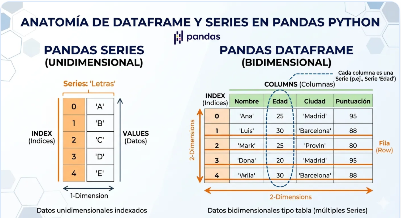
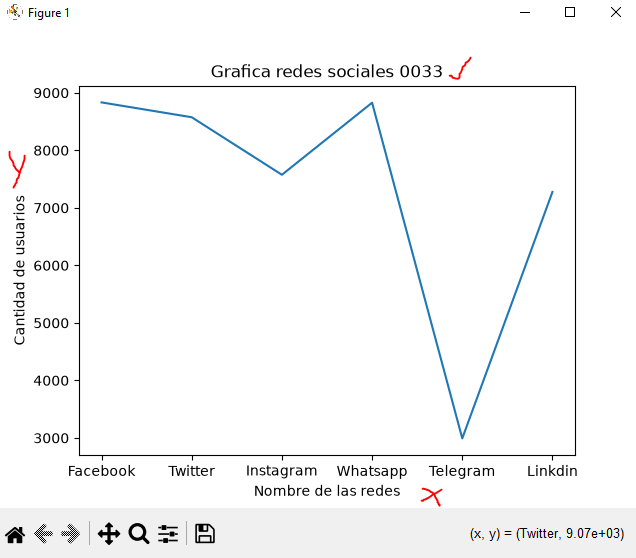
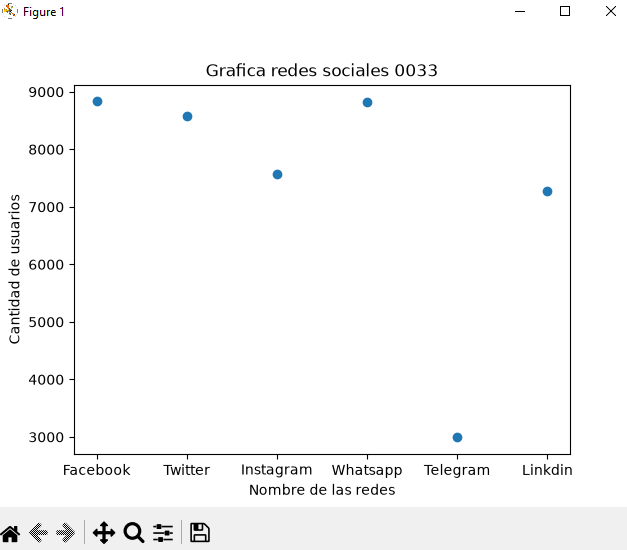
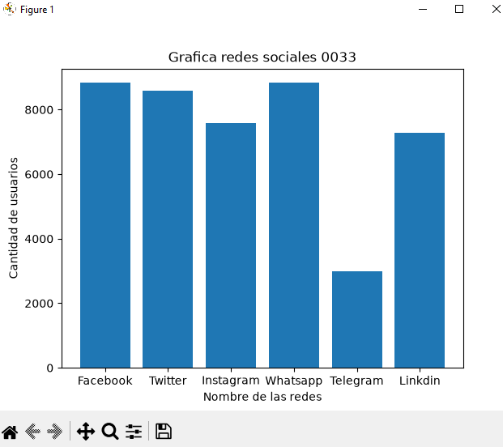
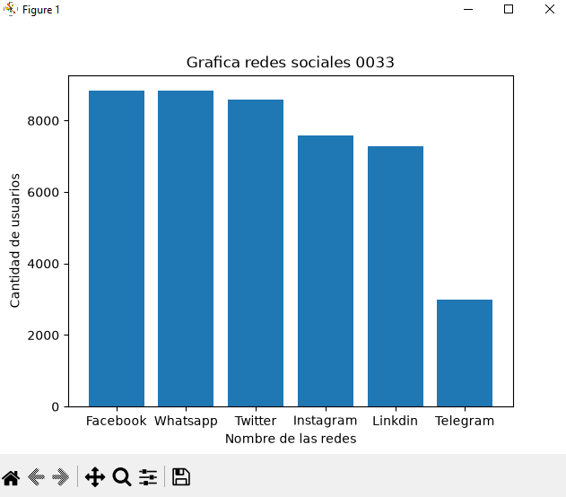
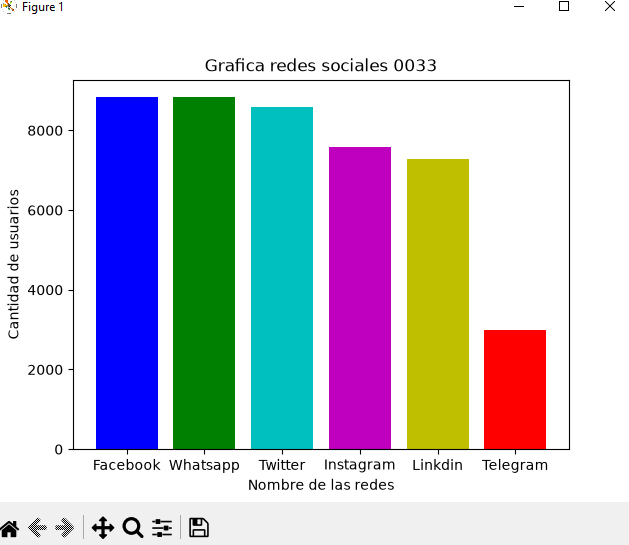
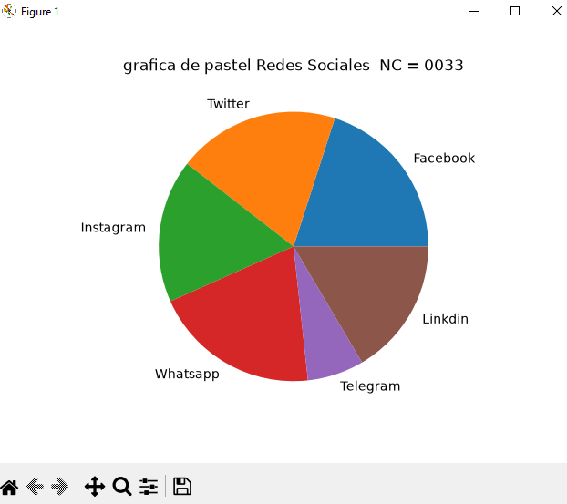

## DataFrame o marco de datos pandas

## Redes Sociales a Nivel Mundial 

## Grafica Lineal de redes sociales 

## Grafica Puntual de Redes Sociales  

## Grafica Barras de Redes Sociales

## Grafica de barras de el mas grande al mas chico descendente 

##  Coloreando la grafica 

## Grafica de pastel o pie 
